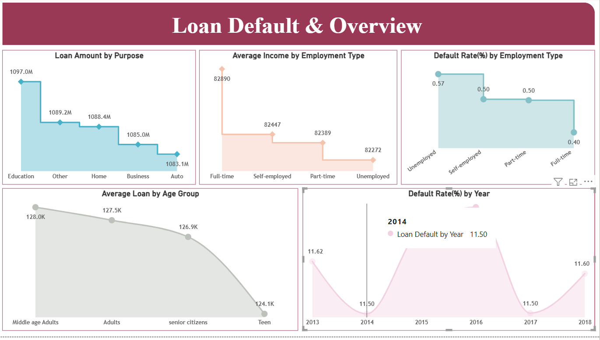
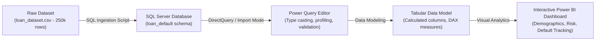
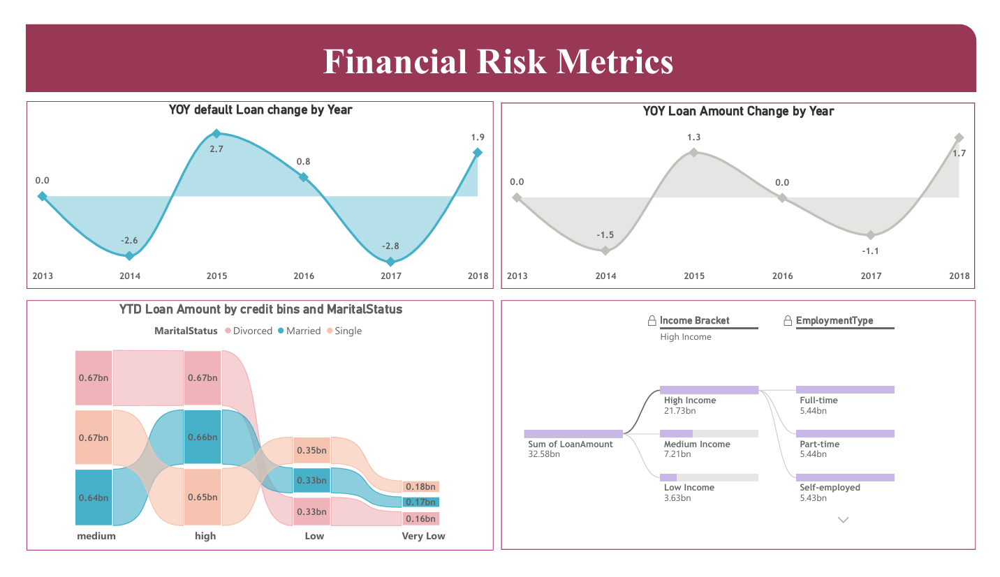

# Loan Default Risk Analysis — Financial Analytics Dashboard (Power BI & SQL) 📊



> An end-to-end financial data analytics and risk intelligence project evaluating **250,000+ loan records** using **SQL Server**, **Power BI**, and **DAX** to analyze borrower default probability across income brackets, employment categories, and credit tiers.

---

## 📌 Project Overview & Objectives

In retail banking and consumer lending, identifying early indicators of credit default is essential for capital preservation and risk-adjusted pricing. 

This project analyzes borrower demographic attributes, financial obligations, and loan terms to:
- Identify high-risk segments based on Debt-to-Income (DTI) ratios and credit history.
- Model multi-year default patterns across distinct employment classifications.
- Formulate dynamic DAX business measures for executive dashboard reporting.

---

## 📊 Dataset Specifications

The dataset comprises **~250,000 borrower records** with 19 financial and demographic dimensions:

| Attribute | Data Type | Description |
| :--- | :--- | :--- |
| `LoanID` | Varchar | Unique transaction identifier |
| `Age` | Integer | Borrower age (18–65+) |
| `Income` | Decimal | Annual verifiable borrower income |
| `LoanAmount` | Decimal | Total principal borrowed |
| `CreditScore` | Integer | Credit bureau score (300–850) |
| `MonthsEmployed` | Integer | Employment tenure in months |
| `NumCreditLines` | Integer | Open revolving and installment credit lines |
| `InterestRate` | Decimal | Annualized loan interest rate (%) |
| `LoanTerm` | Integer | Repayment tenure in months (12, 24, 36, 60) |
| `DTIRatio` | Decimal | Total monthly debt service to gross monthly income |
| `Education` | Varchar | Academic tier (High School, Bachelor, Master, PhD) |
| `EmploymentType` | Varchar | Full-time, Part-time, Self-Employed, Unemployed |
| `MaritalStatus` | Varchar | Single, Married, Divorced |
| `HasMortgage` | Boolean | Existing residential mortgage flag |
| `HasDependents` | Boolean | Financial dependent flag |
| `LoanPurpose` | Varchar | Auto, Business, Education, Home, Personal |
| `HasCoSigner` | Boolean | Presence of co-borrower guarantee |
| `Default` | Binary | Target outcome: Defaulted (`1`) or Repaid (`0`) |
| `Loan Date` | Date | Origination date |

---

## 🔄 End-to-End Data Pipeline



---

## 🧮 Key DAX Analytical Measures

### 1. Loan Amount by Purpose
```dax
Loan Amount by Purpose = 
SUMX(
    FILTER(
        'loan_default',
        NOT(ISBLANK('loan_default'[LoanAmount]))
    ),
    'loan_default'[LoanAmount]
)
```

### 2. Average Income by Employment Type
```dax
Average Income by Employment Type = 
CALCULATE(
    AVERAGE('loan_default'[Income]),
    ALLEXCEPT('loan_default', 'loan_default'[EmploymentType])
)
```

### 3. Default Rate Calculation
```dax
Default Rate % = 
DIVIDE(
    CALCULATE(COUNTROWS('loan_default'), 'loan_default'[Default] = 1),
    COUNTROWS('loan_default'),
    0
)
```

### 4. Median Loan Volume across Credit Score Bins
```dax
Median Loan Amount = 
MEDIANX('loan_default', 'loan_default'[LoanAmount])
```

---

## 🖥️ Dashboard Views

### Page 1: Loan Default & Portfolio Overview

- Macro portfolio distribution across loan purposes (Auto, Education, Mortgage).
- Default rate correlation with borrower employment category.
- Annual default trend tracking.

### Page 2: Applicant Demographics & Financial Profiles

- Volume distribution across income brackets and education levels.
- Co-signer and mortgage presence impact on default rates.

### Page 3: Financial Risk Metrics

- Year-over-Year (YoY) default rate velocity.
- Default clustering across credit score bins.

---

## 📁 Repository Structure

```
loan-default-analysis-powerbi-main/
├── screenshots/
│   ├── dashboard_overview.png
│   ├── demographics.png
│   └── financial_risk.png
├── Loan_Default_Dashboard.pbix    # Complete Power BI report with embedded data model
├── loan_dataset.csv               # 250,000 raw lending transactions
├── powerbi_dashboard.pdf          # High-resolution PDF export for quick review
├── sql_setup.sql                  # Database creation and table indexing script
├── .gitattributes
└── README.md
```

---

## 👨‍💻 Author

**Romit Kumar**
- Department of Electronics & Communication Engineering
- Maulana Azad National Institute of Technology (MANIT), Bhopal
- GitHub: [@RomitGoyal2303](https://github.com/RomitGoyal2303)
- Email: `romigoyal2004@gmail.com`
