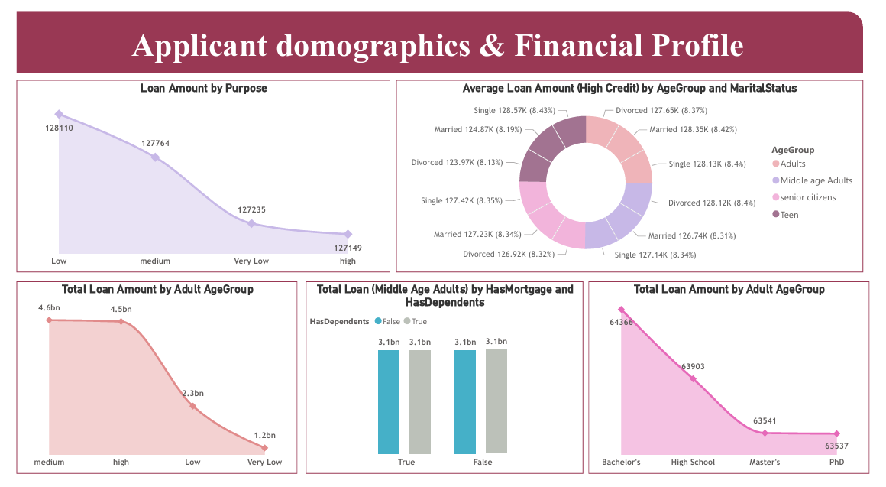
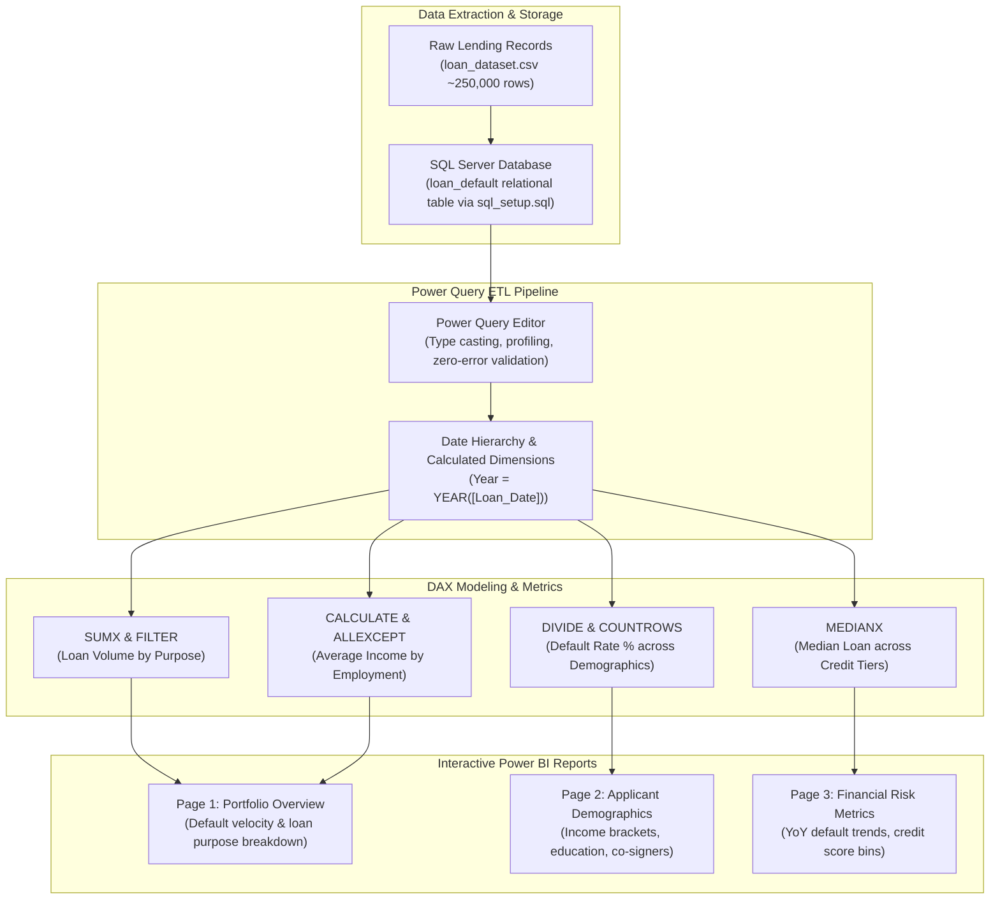

<div align="center">

# Loan Default Risk Analysis — Financial Intelligence Dashboard 📊

**End-to-end financial data analytics and default risk modeling on 250,000+ loan transactions using SQL Server, Power BI, and DAX.**

[](https://powerbi.microsoft.com/)
[](https://www.microsoft.com/sql-server)
[](https://docs.microsoft.com/dax/)
[](#dataset-specifications)

</div>

---

## 📌 Problem Statement & Business Context

In consumer credit lending and retail banking, accurately assessing credit default risk is critical for risk-adjusted loan pricing and portfolio loss prevention. 

Financial institutions face significant exposure when borrowers default on unsecured credit lines, auto financing, and education loans. This project investigates:
- How **Debt-to-Income (DTI) ratios** and credit score distribution correlate with default rates.
- Multi-year default velocity across distinct employment tiers (Full-time, Self-Employed, Part-time, Unemployed).
- Interactive drill-down dashboards that enable credit risk officers to identify high-risk underwriting segments.

---

## 🖥️ Executive Dashboard Views

```carousel

<!-- slide -->

<!-- slide -->

```

---

## 🏗️ End-to-End Data Pipeline



---

## 🧮 Key DAX Analytical Formulations

### 1. Default Rate Percentage
```dax
Default Rate % = 
DIVIDE(
    CALCULATE(COUNTROWS('loan_default'), 'loan_default'[Default] = 1),
    COUNTROWS('loan_default'),
    0
)
```

### 2. Average Income by Employment Classification
```dax
Average Income by Employment Type = 
CALCULATE(
    AVERAGE('loan_default'[Income]),
    ALLEXCEPT('loan_default', 'loan_default'[EmploymentType])
)
```

### 3. Loan Volume Filtered by Purpose
```dax
Loan Amount by Purpose = 
SUMX(
    FILTER(
        'loan_default',
        NOT(ISBLANK('loan_default'[LoanAmount]))
    ),
    'loan_default'[LoanAmount]
)
```

### 4. Median Loan Volume across Credit Score Bins
```dax
Median Loan Amount = 
MEDIANX('loan_default', 'loan_default'[LoanAmount])
```

---

## 📊 Dataset Specifications

The dataset models **250,000+ consumer lending records** with 19 financial and demographic dimensions:

| Attribute | Data Type | Description |
| :--- | :--- | :--- |
| `LoanID` | Varchar | Unique transaction identifier |
| `Age` | Integer | Borrower age (18–65+) |
| `Income` | Decimal | Annual verifiable borrower income |
| `LoanAmount` | Decimal | Total principal borrowed |
| `CreditScore` | Integer | Credit bureau score (300–850) |
| `MonthsEmployed` | Integer | Employment tenure in months |
| `NumCreditLines` | Integer | Open revolving and installment credit lines |
| `InterestRate` | Decimal | Annualized loan interest rate (%) |
| `LoanTerm` | Integer | Repayment tenure in months (12, 24, 36, 60) |
| `DTIRatio` | Decimal | Total monthly debt service to gross monthly income |
| `Education` | Varchar | Academic tier (High School, Bachelor, Master, PhD) |
| `EmploymentType` | Varchar | Full-time, Part-time, Self-Employed, Unemployed |
| `MaritalStatus` | Varchar | Single, Married, Divorced |
| `HasMortgage` | Boolean | Existing residential mortgage flag |
| `HasDependents` | Boolean | Financial dependent flag |
| `LoanPurpose` | Varchar | Auto, Business, Education, Home, Personal |
| `HasCoSigner` | Boolean | Presence of co-borrower guarantee |
| `Default` | Binary | Target outcome: Defaulted (`1`) or Repaid (`0`) |
| `Loan Date` | Date | Origination date |

---

## 📁 Repository Directory Structure

```
loan-default-analysis-powerbi-main/
├── screenshots/
│   ├── dashboard_overview.png     # Macro portfolio distribution & trends
│   ├── demographics.png           # Income brackets & education breakdown
│   └── financial_risk.png         # Credit score bins & YoY risk velocity
├── Loan_Default_Dashboard.pbix    # Complete Power BI report with embedded data model
├── loan_dataset.csv               # 250,000 raw lending transactions
├── powerbi_dashboard.pdf          # High-resolution PDF export for quick review
├── sql_setup.sql                  # Database creation and table indexing script
├── .gitattributes
└── README.md
```

---

## ⚙️ How to Explore & Run Locally

### 1. Prerequisites
- **Power BI Desktop** (Free download from Microsoft)
- **SQL Server / SSMS** (Optional, for running raw SQL ingestion)

### 2. View the Power BI Dashboard
- Clone the repository:
  ```bash
  git clone https://github.com/RomitGoyal2303/loan-default-analysis-powerbi-main.git
  ```
- Double-click `Loan_Default_Dashboard.pbix` to launch the interactive report in Power BI Desktop.
- Alternatively, review the pre-rendered [`powerbi_dashboard.pdf`](file:///C:/Users/asus/.gemini/antigravity/scratch/repos/loan-default-analysis-powerbi-main/powerbi_dashboard.pdf).

---

## 👨‍💻 Author

**Romit Kumar**
- Department of Electronics & Communication Engineering
- Maulana Azad National Institute of Technology (MANIT), Bhopal
- GitHub: [@RomitGoyal2303](https://github.com/RomitGoyal2303)
- Email: `romigoyal2004@gmail.com`
